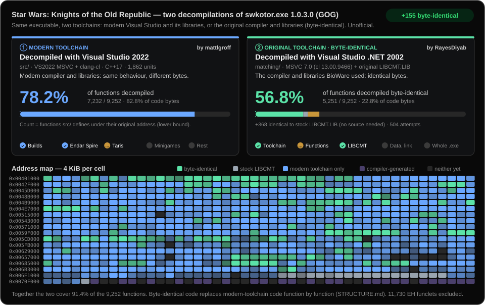

# Matching reconstruction (MSVC 7.0)



This directory holds a second, independent track: C++ source that compiles
with the original toolchain to the **same machine code** as the GOG 1.03
`swkotor.exe`, function by function. It does not change or replace the
playable build under `src/` and is not part of `build.py`.

`swkotor.exe`'s Rich header names the toolchain: Visual Studio .NET 2002
(MSVC 7.0, `cl` 13.00.9466), linked 2004-02-12. With that compiler and
`-O2 -Gy -GX`, every function annotated here is compared byte for byte with
the original.

## Status

When this directory was added, 5,592 functions were annotated and 5,096 of
them were byte-identical. The other 496 are best attempts (`NONMATCH`) kept
for later passes. Rerun the tool with `--report` for current numbers.

## Layout

- `src/<bucket>/*.cpp`: annotated sources. Each bucket (`a`..`m`) covers an
  address range of the executable. The buckets only exist so that parallel
  work never touched the same files. `src/pilot1..3` are the first
  experiments.
- `include/<bucket>/*.h`: class declarations in 2002-era style, with members
  at their original offsets, virtuals in vtable order, and callees declared
  but not defined.
- `tools/matchcmp.py`: the compile-and-compare tool.

Some file comments cite paths in the upstream working repository
(`src/batches/...`, `functions.csv`). These were navigation notes there and
have no counterpart here.

## Annotations

Each function to check carries a marker directly above its definition:

```cpp
// FUNCTION: SWKOTOR 0x00409460
int CExoResMan::Leaf9460(unsigned long a, int b, int c) { ... }
```

Templates, compiler-generated functions and overloads that the name lookup
cannot resolve add the decorated symbol:

```cpp
// FUNCTION: SWKOTOR 0x004233c0 SYMBOL: ??_GCAurTextureBasic@@UAEPAXI@Z
```

Bytes covered by a relocation in our object file (call targets, global
addresses) are masked on both sides. Everything else must be identical, and
the rest of the original function's range must be padding.

## Running the comparison

Requirements:

- Visual Studio .NET 2002 (MSVC 7.0) from your own licensed copy, with the
  directory that contains `BIN\CL.EXE` and `INCLUDE`. It is not
  redistributable and is not included here.
- Your purchased GOG 1.03 `swkotor.exe`, SHA-256
  `9c10e0450a6eeca417e036e3cde7474fed1f0a92aab018446d156944dea91435`, kept
  outside this checkout.
- Python with `pefile` (see [BUILDING.md](../BUILDING.md)).

```powershell
python .\matching\tools\matchcmp.py --msvc "C:\Tools\msvc7" --exe "D:\Games\Star Wars - KotOR\swkotor.exe" -q matching\src
```

- `-v` prints a side-by-side disassembly (original | ours) for misses, with
  `!!` marking the differing instructions.
- `--report status.csv` writes one row per annotated function. Write it
  outside the checkout.
- `--function-table` takes an optional CSV of function starts (an `address`
  column). Without one, function ends come from the annotations and the
  original's direct call targets. That is slightly stricter: on the current
  sources it reports 2 of the 5,096 matches as misses, and it has never
  produced a false match.
- On Linux and macOS the compiler runs under Wine. `KOTOR_WINE` names the
  launcher.
- Use the dash form of the flags (`-O2`, not `/O2`) from Git Bash, which
  rewrites `/O2` into a path.

## Banner

`matching/assets/progress.svg` (shown in the top-level README) is written by
`tools/render_banner.py` from a `--report` CSV and a function table. The
playable-build milestones in it are copied from [STATUS.md](../STATUS.md);
update `PLAYABLE` in the script when that changes. The committed banner
counts 9,196 functions: the 8,667 non-compiler-generated entries of the
upstream Ghidra function table, plus 529 annotated functions that table had
missed.

## Source-shape notes

These patterns made functions match:

- BioWare used inline getters heavily (`g_pRules->Get2DArrays()->...`). They
  change load order and register allocation.
- The `if` body is laid out first. Invert the condition to flip the layout.
- `if (a || b) return;` sometimes has to be two separate `if`s.
- Declare address-taken locals in the narrowest block; this decides their
  stack slots.
- Classes passed by value (`CResRef`) need a declared copy constructor.
- `#pragma pack(4)` is needed where an `__int64` member sits at a 4-aligned
  offset.
- An `fs:[0]` frame in the original means `-GX` plus a local object with a
  destructor.
